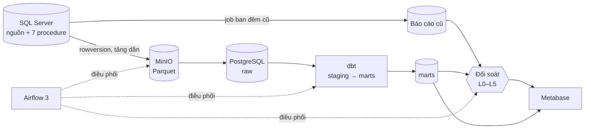
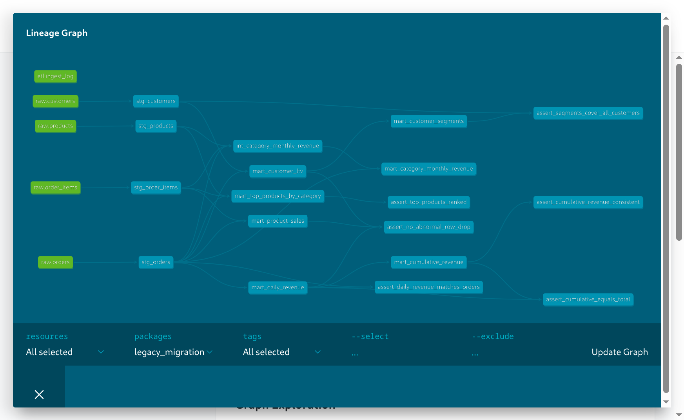

# Legacy migration: SQL Server → Airflow + dbt

Dự án mô phỏng việc di chuyển hệ thống báo cáo của một công ty bán lẻ: 7 báo
cáo đang chạy bằng stored procedure T-SQL trong job ban đêm trên SQL Server được
viết lại thành pipeline ELT gồm Airflow, MinIO (S3), PostgreSQL và dbt. Trọng tâm
là **chứng minh số liệu mới khớp số liệu cũ** trước khi chuyển: hai hệ thống chạy
song song, được đối soát tự động mỗi đêm ở 5 cấp, và chỉ chuyển khi đủ 5 ngày
xanh liên tiếp.

## Số liệu chính

| | |
|---|---|
| Stored procedure đã chuyển | 7/7 (CURSOR, WHILE, MERGE, SQL động + PIVOT, bảng tạm nhiều tầng, biến bảng) |
| Dữ liệu nguồn | ~2.000 khách hàng, 60 sản phẩm, ~20.000 đơn, ~60.000 dòng chi tiết |
| dbt | 12 model (staging, intermediate, marts), 49 test |
| Đối soát | 5 cấp (số dòng, tổng hợp, theo nhóm, từng dòng, checksum) + kiểm tra cùng lát cắt dữ liệu |
| Lỗi cố ý đã bắt được | 3 ca: lệch múi giờ, sửa tay báo cáo cũ, nguồn đổi sau khi tải ([chi tiết](./docs/reconciliation.md#8-cố-tình-tạo-lỗi-và-chứng-minh-đối-soát-bắt-được)) |
| CI | Ruff, unit test, dbt build trên dữ liệu mẫu + so con số kỳ vọng, SQLFluff, Terraform plan |

## Kiến trúc



Chi tiết từng thành phần, luồng DAG, schema và cách đưa lên AWS:
[docs/architecture.md](./docs/architecture.md).

## Yêu cầu

- Docker Engine + Docker Compose v2 (hoặc Docker Desktop), cấp ít nhất **6 GB RAM**
  khi chạy cả Airflow. Volume đã gắn nhãn `:z` nên chạy được trên Fedora có SELinux.
- Python 3.12 trở lên, `make`, Git.
- Terraform (chỉ cần cho `make tf-validate`/`tf-plan`), xem [terraform/README.md](./terraform/README.md).
- Các cổng 1433, 3000, 5432, 8080, 9000, 9001 còn trống trên `127.0.0.1`.

## Chạy từ đầu (thời gian phụ thuộc tải image; chưa đo trên máy sạch)

```bash
git clone <url-repo> legacy-migration && cd legacy-migration
make env                                   # tạo .env từ .env.example
python3 -m venv .venv && source .venv/bin/activate
pip install -r requirements.txt -r requirements-dbt.txt -r requirements-dev.txt
```

**1. Hệ thống cũ**

```bash
make up       # SQL Server + schema + 8 stored procedure (đợi sql-init báo hoàn tất)
make data     # sinh dữ liệu mẫu cố định (seed 42)
make batch    # chạy job ban đêm cũ
make check    # doanh thu 7 ngày gần nhất và phân bố segment
```

**2. Warehouse, data lake, Airflow**

```bash
make wh          # PostgreSQL: schema raw, etl, recon, user bi_reader
make minio       # MinIO + bucket
make airflow     # build image Airflow (lần đầu vài phút) và khởi động
make airflow-pass
```

Mở <http://localhost:8080>, đăng nhập bằng user và mật khẩu vừa in ra, rồi
trigger DAG **`ingest_legacy`**. Các DAG còn lại tự chạy theo Asset:
`legacy_nightly_batch` và `transform_dbt`, sau đó `reconciliation`. Khi
`reconciliation` xanh, cả 7 báo cáo đã khớp.

Không muốn dùng Airflow thì chạy tay theo đúng thứ tự:

```bash
make ingest-all && make legacy-batch && make dbt-build && make recon
```

`make ingest-all` chạy cả phát hiện xóa và lưu snapshot Parquet đầy đủ.
`make dbt-build` ghi lại batch đầu vào và kết quả build. Build một phần qua
`SELECT=...` trả mã 2 và không dùng để nghiệm thu; sau khi debug phải build lại toàn bộ.

**3. Dashboard và tài liệu dbt**

```bash
make metabase    # http://localhost:3000, dựng dashboard theo metabase/README.md
make reports     # http://localhost:3001, link cố định để cutover/rollback
make dbt-docs    # http://localhost:8081, xem lineage
```

[Video portfolio 3 phút](./docs/legacy-migration-demo.mp4) · [Nguồn video](./demo/README.md)




## Kiểm thử, CI và điều kiện cutover

| Lệnh | Việc |
|---|---|
| `make test` | Unit test cho logic đối soát, guard phát hiện xóa, điều kiện cutover |
| `make lint` | Ruff + SQLFluff (cần `make wh` đang chạy) |
| `make dbt-build` | Build và test toàn bộ model trên dữ liệu thật |
| `make ci-local` | Tạo database test riêng, chạy lint/test/dbt/golden, tự xóa database test; Terraform validate/plan |
| `make readiness` | In 10 ngày đối soát gần nhất; exit 0 khi đủ 5 ngày xanh liên tiếp |
| `make tf-plan` | Terraform plan hạ tầng AWS bằng khóa giả, không cần tài khoản |

GitHub Actions ([ci.yml](./.github/workflows/ci.yml)) chạy ở mỗi pull request:
Postgres trống, nạp [dữ liệu mẫu](./ci/sample_raw_data.sql) có sẵn các trường hợp
biên, `dbt build`, rồi so con số mart với
[kết quả kỳ vọng](./ci/assert_expected_marts.sql). Cần bật ruleset/branch protection
và yêu cầu status checks trên GitHub; YAML CI tự nó không chặn merge.
Ruleset hiện tại yêu cầu Python và dbt. Job dbt giữ tên cũ để tương thích rule,
chỉ xanh nếu Terraform thành công; bước kiểm tra vẫn chạy khi Terraform lỗi.
Commit source 58927d0 đã xanh trên [PR #2](https://github.com/druy3april/legacy-migration/pull/2);
xem [bằng chứng CI](./docs/evidence/github-ci-2026-10-15.json).

Xem toàn bộ lệnh bằng `make help`.

## Tài liệu

| Tài liệu | Nội dung |
|---|---|
| [architecture.md](./docs/architecture.md) | Thành phần, luồng DAG, schema, đưa lên AWS, khi dữ liệu gấp 100 lần |
| [migration_notes.md](./docs/migration_notes.md) | Cách chuyển từng stored procedure, chỗ dễ lệch |
| [reconciliation.md](./docs/reconciliation.md) | Phương pháp đối soát, ngưỡng, 3 ca lỗi cố ý, nhật ký chạy song song |
| [cutover_plan.md](./docs/cutover_plan.md) | Điều kiện Go/No-Go, các bước chuyển, rollback |
| [cost_estimate.md](./docs/cost_estimate.md) | So sánh chi phí SQL Server báo cáo với AWS, giả định và nguồn giá |
| [ADR](./docs/adr/) | 0001 xử lý xóa · 0002 raw upsert · 0003 pivot động · 0004 ngưỡng sai số · 0005 rowversion · 0006 chọn dbt |
| [lessons_learned.md](./docs/lessons_learned.md) | Lỗi đã gặp, nguyên nhân, cách sửa |
| [evidence/](./docs/evidence/) | Bằng chứng tiêu chí Tuần 2 và đối chiếu ban đầu |
| [terraform/](./terraform/README.md) | Hạ tầng tương đương trên AWS (chỉ plan) |
| [demo_script.md](./docs/demo_script.md) | Kịch bản video demo 3–5 phút |

## Cấu trúc thư mục

```
legacy-migration/
├── docker-compose.yml, Makefile, .env.example
├── sql/                  # schema + stored procedure của hệ thống cũ
├── scripts/              # sinh dữ liệu, ingestion tăng dần, giả lập thay đổi nguồn
├── warehouse/init.sql    # schema raw, etl, recon, view đối soát và cutover
├── airflow/dags/         # ingest_legacy, legacy_nightly_batch, transform_dbt, reconciliation
├── dbt_project/          # models/{staging,intermediate,marts}, tests, macros
├── reconciliation/       # đối soát 5 cấp, snapshot, điều kiện cutover
├── metabase/             # SQL câu hỏi Q1–Q6 và cấu hình dashboard
├── tests/                # unit test
├── ci/                   # dữ liệu mẫu và kết quả kỳ vọng cho CI
├── terraform/            # S3, Redshift Serverless, IAM (chỉ plan)
├── docs/                 # kiến trúc, ADR, đối soát, cutover, chi phí
└── .github/workflows/    # CI
```

## Kiểm thử tích hợp và phục hồi

```bash
PYTHONPATH=scripts:. .venv/bin/python scripts/integration_lab.py
make restore-raw MANIFEST=manifests/<sha256>.json RESTORE_DB=restore_lab
```

Bài test tạo database và bucket tạm riêng, kiểm tra tải lặp, xóa cứng, đối soát,
khôi phục hai lần và build một phần; tự dọn tài nguyên test. Lệnh restore chỉ nhận
database `restore_*`, từ chối ghi đè database đang dùng. Nó khôi phục raw và
tombstone, không thay watermark của pipeline đang chạy.

## Bàn giao và vận hành

[Bằng chứng ngày 15/10/2026](./docs/evidence/completion-2026-10-15.md)
phân biệt phần đã PASS với phần còn phải chờ. Phụ lục trong hướng dẫn là bản
vá lịch sử, đã áp dụng; không cần chép hay áp dụng lại.

```bash
make audit
make readiness
make reports
make reports-status
make rehearse
# Sau khi đủ điều kiện Go:
make cutover
# Khi cần quay lại:
make rollback
```

Link chung http://localhost:3001 đọc `metabase/active-dashboard.json` mỗi lần
truy cập. Cutover chỉ đổi link đích; dashboard OLD vẫn giữ để rollback.
`make rehearse` dùng cấu hình tạm và không đổi link chung.

## Tiến độ

| Tuần | Nội dung | Trạng thái |
|---|---|---|
| 1 | Hệ thống nguồn SQL Server và 7 stored procedure | Hoàn thành |
| 2 | Ingestion, replay snapshot có tombstone | Đã kiểm tra cả snapshot thật và bài test cô lập |
| 3–4 | Chuyển 7 procedure sang dbt, test, lineage | Hoàn thành |
| 5 | Đối soát 5 cấp, DAG, dashboard | 7/7 PASS; Q4 đã sửa; hai dashboard mỗi bên 7 báo cáo |
| 6 | CI, Terraform, chi phí, cutover/rollback, tài liệu | Local + GitHub CI xanh; Terraform và rehearsal PASS; Go chờ đủ 5 ngày |
| 6 | Video demo | Video portfolio 3 phút; nguồn và bằng chứng ở docs/demo |
| — | Chạy song song tới khi đủ 5 ngày xanh | Đang đếm (`make readiness`) |

## Xử lý sự cố thường gặp

| Triệu chứng | Cách xử lý |
|---|---|
| Container SQL Server tự tắt | Tăng RAM cho Docker lên ít nhất 4 GB |
| `make lint` báo không kết nối được database | SQLFluff dùng dbt templater, cần `make wh` đang chạy |
| DAG không hiện trong Airflow | `make dag-check` để xem lỗi import |
| Đối soát toàn `SKIP` | Báo cáo cũ và raw khác lát cắt dữ liệu; đừng chạy `simulate` giữa ingestion và batch, trigger lại `ingest_legacy` |
| `make tf-validate` báo chưa cài terraform | Xem [terraform/README.md](./terraform/README.md) |
