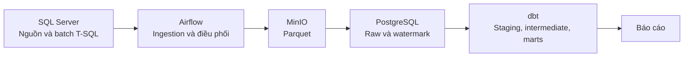

# Legacy migration

Dự án mô phỏng chuyển đổi hệ thống bán lẻ từ SQL Server với batch T-SQL sang
pipeline dữ liệu dùng Airflow, MinIO, PostgreSQL và dbt.

## 0. Tiến độ

| Tuần | Nội dung | Trạng thái |
|---|---|---|
| 1 | Dựng hệ thống nguồn SQL Server và batch T-SQL | Hoàn thành |
| 2 | Ingestion tăng dần qua Airflow, Parquet/MinIO và raw PostgreSQL | Hoàn thành |
| 3–4 | Chuyển 7 stored procedure sang dbt, kiểm thử và đối soát | Hoàn thành |
| 5 | Kiểm thử snapshot, đối soát dữ liệu và dashboard BI | Hoàn thành |
| 6 | Hoàn thiện tài liệu dự án | Hoàn thành |

## Bắt đầu

Xem toàn bộ lệnh và tham số được hỗ trợ bằng `make help`. Luồng dựng warehouse,
chạy đối soát và mở dashboard được mô tả trong
[tài liệu đối soát](./docs/reconciliation.md) và
[hướng dẫn khôi phục dashboard Metabase](./metabase/README.md).

Các câu hỏi Q1–Q6 được lưu dưới dạng SQL trong `metabase/questions/`; cấu hình
biểu đồ và bố cục dashboard được lưu tại `metabase/dashboard.json` để có thể
tạo lại sau khi dựng môi trường mới.

## Kiến trúc

**Lưu ý đối soát:** `make ingest-all` không chạy `detect_deletes`. Khi cần
đối soát dữ liệu sau khi nguồn có xóa cứng, hãy chạy ingestion qua DAG
`ingest_legacy`; bước `detect_deletes` trong DAG sẽ đánh dấu tombstone ở raw.
