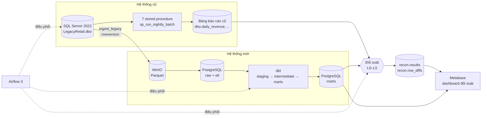
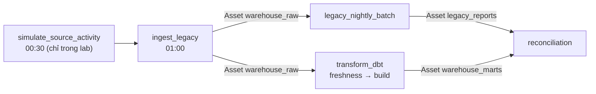

# Kiến trúc

Tài liệu này mô tả các thành phần của dự án, dữ liệu đi qua chúng như thế nào,
và những gì phải đổi khi đưa lên cloud. Lý do của từng quyết định nằm trong
[các ADR](./adr/).

## 1. Sơ đồ tổng thể

## 2. Thành phần

| Thành phần | Phiên bản | Cổng (chỉ 127.0.0.1) | Vai trò | Dữ liệu lưu ở |
|---|---|---|---|---|
| SQL Server | 2022 (Developer) | 1433 | Hệ thống cũ: 4 bảng nguồn, 7 bảng báo cáo, 8 stored procedure | Volume `sqlserver_data` |
| MinIO | `RELEASE.2026-06-18` | 9000, console 9001 | Vùng đệm file, API giống S3; lưu Parquet bất biến của mỗi lần tải | Volume `minio_data` |
| PostgreSQL | 16 | 5432 | Warehouse; đồng thời chứa database metadata của Airflow và Metabase | Volume `postgres_data` |
| Airflow | 3.3.1, LocalExecutor | 8080 | Lên lịch, retry, cảnh báo, nối các DAG bằng Asset | DAG trong `airflow/dags`, log ở volume `airflow_logs` |
| dbt Core | 1.12 + dbt-postgres 1.11 | — | Biến đổi raw thành mart, test dữ liệu, lineage | Code trong `dbt_project/` |
| Metabase | v0.58 | 3000 | Dashboard trạng thái đối soát | Database `metabase`; câu hỏi lưu dạng SQL trong `metabase/` |

Mọi cổng chỉ mở trên `127.0.0.1`. Mật khẩu nằm trong `.env` (không commit).
Metabase đọc warehouse bằng user `bi_reader`, chỉ có quyền `SELECT` trên schema
`recon` và `marts`.

## 3. Luồng chạy hằng đêm

Giờ theo `Asia/Ho_Chi_Minh`. Chỉ hai DAG có lịch cố định; các DAG còn lại chạy
khi Asset đầu vào được cập nhật, nên không phải đoán thời gian chờ giữa các bước.

| DAG | Kích hoạt | Việc chính | Khi lỗi |
|---|---|---|---|
| `ingest_legacy` | 01:00 hằng ngày | Đọc cận trên rowversion một lần; 4 task tải song song (dynamic task mapping); `detect_deletes`; phát `warehouse_raw` | Retry 3 lần (backoff); lỗi schema hoặc tỷ lệ xóa bất thường thì dừng ngay, không retry; gửi email |
| `legacy_nightly_batch` | `warehouse_raw` | Chạy `sp_run_nightly_batch`, ghi fingerprint nguồn trước/sau vào `recon.legacy_batches` | Nguồn đổi giữa lúc chạy thì báo lỗi và retry |
| `transform_dbt` | `warehouse_raw` | `dbt source freshness` rồi `dbt build`; chỉ phát `warehouse_marts` khi xanh | Retry 1 lần; email |
| `reconciliation` | `warehouse_marts` **và** `legacy_reports` | Kiểm tra snapshot (L0), so 7 báo cáo ở 5 cấp, ghi `recon.results` | Có FAIL thì DAG đỏ ngay, không retry, gửi email |

## 4. Dữ liệu theo schema

| Schema | Ai ghi | Nội dung |
|---|---|---|
| `raw` | `ingest_legacy` | Bản sao trạng thái hiện tại của 4 bảng nguồn, upsert theo khóa, cột `_deleted_at` đánh dấu dòng đã xóa ở nguồn ([ADR-0002](./adr/0002-raw-dang-upsert.md)) |
| `etl` | `ingest_legacy` | `watermarks` (mốc rowversion mỗi bảng) và `ingest_log` (mỗi lần tải một dòng/bảng, dùng cho freshness) |
| `staging` | dbt (view) | Làm sạch nhẹ, ép kiểu, lọc `_deleted_at IS NULL` |
| `intermediate` | dbt (view) | `int_category_monthly_revenue` dạng dọc, ổn định schema |
| `marts` | dbt (table) | 7 bảng thay cho 7 procedure |
| `audit` | dbt hook | Số dòng mỗi mart sau mỗi lần build thành công |
| `recon` | Module đối soát | Kết quả từng phép so, mẫu dòng lệch, fingerprint batch cũ, các view cho dashboard và cutover |

Thêm vào đó, MinIO giữ mọi file Parquet đã tải theo khóa
`raw/<bảng>/incremental/rv_<từ>_<đến>.parquet`, nên có thể phát lại lịch sử khi
cần backfill.

## 5. Tính đúng và khả năng phục hồi

| Rủi ro | Cách xử lý | Tài liệu |
|---|---|---|
| Bỏ sót dòng của transaction đang mở | Cận trên `MIN_ACTIVE_ROWVERSION() - 1` | [ADR-0005](./adr/0005-bat-thay-doi-bang-rowversion.md) |
| Chạy lại gây trùng | Key Parquet xác định theo khoảng rowversion; upsert chỉ ghi khi `row_ver` mới hơn | [ADR-0002](./adr/0002-raw-dang-upsert.md) |
| Dòng bị xóa ở nguồn | So tập khóa sau mỗi lần tải; chặn khi tỷ lệ xóa vượt 5% | [ADR-0001](./adr/0001-xu-ly-dong-bi-xoa.md) |
| Nguồn đổi schema | So danh sách cột trước khi tải; lệch thì dừng | [ADR-0005](./adr/0005-bat-thay-doi-bang-rowversion.md) |
| So hai lát cắt dữ liệu khác nhau | Fingerprint nguồn; lệch thì SKIP thay vì FAIL giả | [ADR-0004](./adr/0004-nguong-sai-so-va-snapshot-doi-soat.md) |
| Sai logic khi sửa model | dbt test + golden test trên dữ liệu mẫu trong CI + đối soát hằng đêm | [reconciliation.md](./reconciliation.md) |

## 6. CI/CD

GitHub Actions ([.github/workflows/ci.yml](../.github/workflows/ci.yml)) chạy
ba job song song ở mỗi pull request:

1. **Python:** ruff lint, ruff format, unit test (`tests/`).
2. **dbt:** dựng Postgres trống, chạy `warehouse/init.sql`, nạp
   `ci/sample_raw_data.sql`, rồi `dbt compile`, `dbt build`, `dbt source freshness`,
   so con số mart với `ci/assert_expected_marts.sql`, và SQLFluff.
3. **Terraform:** `fmt -check`, `validate`, `plan` với khóa giả.

`make ci-local` chạy các bước tương tự trên máy với dữ liệu thật.

## 7. Đưa lên cloud

Code hạ tầng cho AWS nằm trong [terraform/](../terraform/README.md) (chỉ `plan`).

| Local | AWS | Ghi chú |
|---|---|---|
| MinIO | S3 (versioning, mã hóa, chặn public) | `boto3` đã dùng API S3, chỉ đổi endpoint và thông tin đăng nhập |
| PostgreSQL warehouse | Redshift Serverless | Đổi adapter sang `dbt-redshift` |
| Airflow trong Docker | Amazon MWAA | DAG giữ nguyên; mật khẩu SQL Server lấy từ Secrets Manager |
| Metabase | Metabase tự host hoặc QuickSight | |
| `.env` | Secrets Manager + IAM role | Không còn mật khẩu trong file |

Những chỗ đang dùng cú pháp riêng của PostgreSQL phải sửa khi chuyển sang
Redshift:

| Vị trí | Cú pháp hiện tại | Thay bằng |
|---|---|---|
| `mart_cumulative_revenue` | `generate_series` để tạo bảng lịch | Macro `dbt_utils.date_spine` hoặc bảng lịch dựng sẵn |
| `mart_category_monthly_revenue` | `sum(...) filter (where ...)` | `sum(case when ... then ... end)` |
| `ingest_incremental.py` | Upsert `INSERT ... ON CONFLICT` từng dòng | `COPY` Parquet từ S3 vào bảng tạm, rồi `MERGE` |
| `warehouse/init.sql` | `DO $$ ... $$`, `\gexec`, `BIGSERIAL` | Tách thành migration riêng cho Redshift (`IDENTITY`) |

## 8. Nếu dữ liệu lớn gấp 100 lần

| Phần | Hiện tại | Khi gấp 100 lần |
|---|---|---|
| Trích xuất | `fetchall()` cả lô vào bộ nhớ | Đọc theo lô (`fetchmany`) và ghi nhiều file Parquet |
| Nạp raw | `executemany` từng dòng | `COPY` vào bảng tạm rồi upsert theo tập |
| Phát hiện xóa | Quét toàn bộ khóa mỗi đêm | Change Tracking (ngưỡng trong ADR-0001) |
| dbt | Mọi mart là `table`, build lại toàn bộ | Mart lớn chuyển sang `incremental` với `unique_key` |
| Đối soát | Kéo cả bảng báo cáo về Python | Tính L1/L2 và checksum theo bucket ngay trong database, chỉ kéo bucket lệch về so từng dòng ([reconciliation.md](./reconciliation.md), mục 10) |
