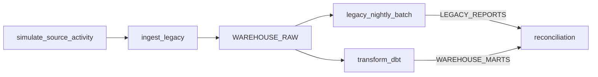
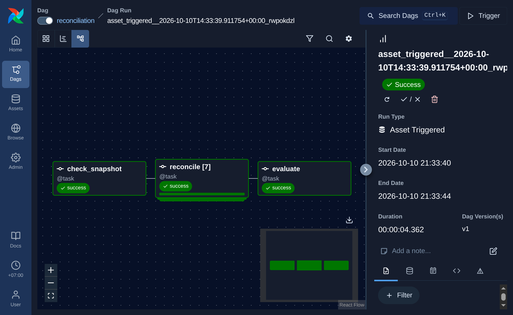
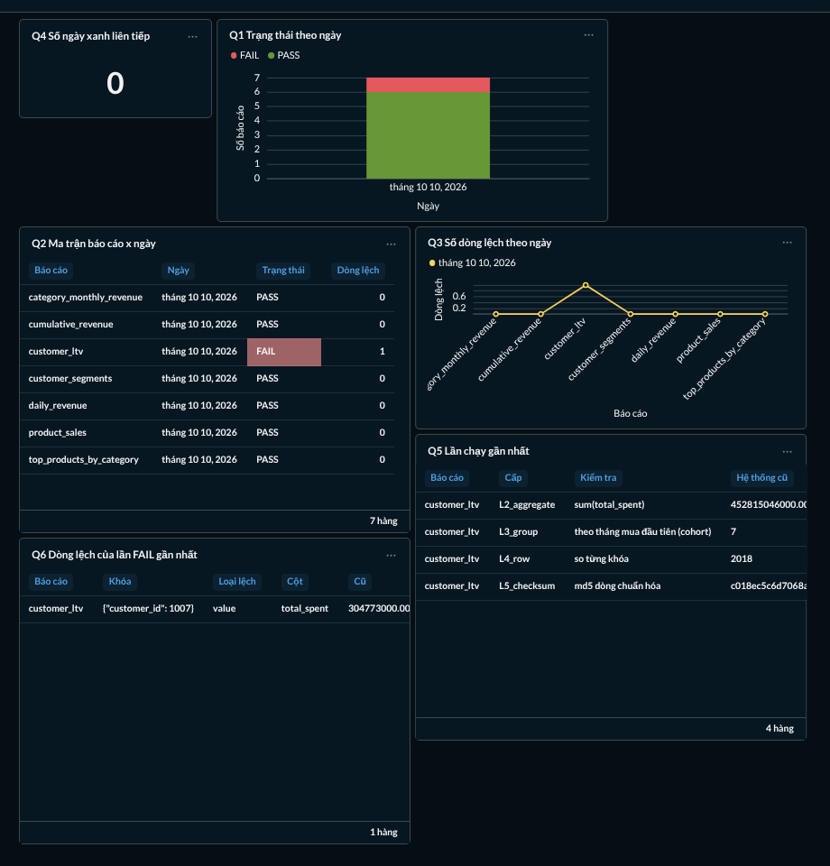

# Đối soát SQL Server ↔ dbt

## 1. Mục tiêu và phạm vi

Đối chiếu kết quả 7 báo cáo của hệ thống cũ trên SQL Server với các mart dbt
trên Postgres:

- `daily_revenue`
- `customer_ltv`
- `customer_segments`
- `product_sales`
- `cumulative_revenue`
- `top_products_by_category`
- `category_monthly_revenue`

Mục tiêu là phát hiện sai khác dữ liệu, đồng thời chỉ so sánh khi báo cáo cũ
và mart mới đại diện cho cùng một trạng thái nguồn.

## 2. Luồng chạy

Hoạt động nguồn giả lập chạy trước ingestion. Khi ingestion phát hành
`WAREHOUSE_RAW`, DAG batch cũ và DAG dbt chạy độc lập; reconciliation chỉ chạy
khi đã có cả `LEGACY_REPORTS` và `WAREHOUSE_MARTS`.

Graph view của DAG đối soát trong Airflow:

## 3. Quy tắc snapshot

Batch SQL Server ghi dấu vân tay trước và sau khi chạy: số dòng và
`MAX(row_ver)` của bốn bảng nguồn (`customers`, `products`, `orders`,
`order_items`). Snapshot batch phải ổn định; fingerprint sau batch phải bằng
fingerprint của các dòng raw hiện hành mà dbt sử dụng (không tính tombstone).

Nếu chưa có batch, batch không ổn định, hoặc fingerprint khác nhau, cả 7 báo
cáo được đánh dấu `SKIP` tại `L0_snapshot`, không phải `FAIL`: hai phía đang
đại diện cho các lát cắt dữ liệu khác nhau nên chưa có cơ sở kết luận logic
báo cáo sai. `SKIP` không phải thành công; cần sửa luồng hoặc chờ một lần chạy
cùng snapshot. `--ignore-snapshot` chỉ dành cho điều tra.

## 4. Năm cấp độ so sánh

| Cấp | Kiểm tra | Phát hiện |
|---|---|---|
| L1 | Số dòng; riêng báo cáo pivot còn so tập cột tháng | Thiếu/thừa dòng hoặc schema tháng khác nhau |
| L2 | `SUM`, `MIN`, `MAX`, số NULL; distinct count cho chữ | Tổng hợp toàn bảng khác nhau |
| L3 | Số dòng và tổng measure theo nhóm nghiệp vụ | Sai lệch bị che bởi tổng toàn bảng, như theo ngày/tháng/segment |
| L4 | So từng khóa và từng giá trị; phân loại dòng chỉ có ở một phía, giá trị khác, khóa trùng hoặc hòa hạng | Sai khác cụ thể đến từng dòng |
| L5 | MD5 trên dòng đã chuẩn hóa, toàn bảng và 16 bucket | Kiểm tra toàn vẹn bổ sung; checksum lệch được `WARN` nếu L4 đã chấp nhận sai số/hòa hạng, nếu không thì `FAIL` |

## 5. Ngưỡng sai số và chuẩn hóa

| Kiểu | Quy tắc | Lý do |
|---|---|---|
| Tiền | Làm tròn về 2 chữ số thập phân; lệch ≤ 0,01 VND được chấp nhận | `DECIMAL`/`NUMERIC` chính xác; ngưỡng phòng sai số float sau này |
| Ngày | Chuẩn hóa thành chuỗi `YYYY-MM-DD`; `datetime` lấy phần ngày | SQL Server trả `DATE`, Postgres trả `date`; bỏ phần giờ |
| Chữ | Unicode NFC + trim khoảng trắng đầu/cuối; phân biệt hoa thường | Chuẩn hóa tiếng Việt; collation SQL Server không chi phối phép so giá trị đã đọc |
| NULL | `NULL` khác `0` | ADR-0003: tháng không có doanh thu hợp lệ có thể là `NULL` |

Giá trị tiền được chuyển qua chuỗi trước khi tạo `Decimal`, sau đó lượng tử hóa
với `ROUND_HALF_UP`. Cột kiểu số nguyên so sánh chính xác.

## 6. Chênh lệch có chủ đích (được chấp nhận)

| Báo cáo | Chênh lệch | Xử lý | Tham chiếu |
|---|---|---|---|
| `top_products_by_category` | Hòa doanh thu tại ranh giới top 3 có thể chọn sản phẩm khác | Nếu chỉ khác `product_id`/`product_name` mà doanh thu khớp thì `WARN`, không `FAIL` | [migration_notes.md, mục 7](./migration_notes.md) |
| Mọi báo cáo có ngày | Ngày hiện tính theo UTC như hệ thống cũ, không theo giờ Việt Nam | Giữ nguyên trong thời gian di chuyển; chỉ đổi sau cutover khi nghiệp vụ phê duyệt | Ca 1; [ADR-0004](./adr/0004-nguong-sai-so-va-snapshot-doi-soat.md) |
| `category_monthly_revenue` | Schema pivot thay đổi khi xuất hiện tháng mới | So sánh tập cột tháng tại L1; `NULL` vẫn khác 0 | [ADR-0003](./adr/0003-bao-cao-pivot-dong.md) |

## 7. Các cạm bẫy đã kiểm tra

- **Múi giờ:** Đã cố ý đổi `order_day` từ ngày UTC sang giờ Việt Nam. Tổng doanh
  thu toàn bảng vẫn khớp nhưng phân bổ theo ngày sai; L3/L4/L5 phát hiện.
- **Collation:** Chuẩn hóa chuỗi bằng NFC và trim, không chuyển hoa/thường.
  So sánh chạy trên giá trị Python đã đọc, nên collation không thể làm hai giá
  trị khác hoa/thường được coi là bằng nhau.
- **Thứ tự NULL:** Không dựa vào thứ tự dòng do hai engine trả về; đối chiếu
  qua khóa và nhóm. `NULL` được giữ rõ ràng khi so giá trị.
- **NULL trong SUM:** Phép tổng bỏ qua giá trị `NULL` nhưng L2 cũng so riêng số
  NULL; L4 coi `NULL` khác số 0. Ca pivot kiểm tra cụ thể `NULL` so với 0.
- **Làm tròn:** Tiền được chuẩn hóa thành `Decimal` hai chữ số và so với ngưỡng
  0,01; unit test xác nhận L4 có thể PASS trong ngưỡng trong khi checksum tuyệt
  đối đưa ra `WARN`.
- **Dữ liệu đến trễ/thay đổi sau ingest:** Ca 3 mô phỏng nguồn thay đổi sau
  ingestion. Snapshot mismatch khiến cả 7 báo cáo `SKIP`, tránh báo `FAIL`
  giả giữa hai lát cắt khác nhau.

## 8. Cố tình tạo lỗi và chứng minh đối soát bắt được

Thực hiện trên Docker Compose local ngày 2026-10-10. Mỗi ca được chạy trên
snapshot tương ứng; các ca thay đổi dữ liệu được khôi phục trước khi chuyển
sang ca tiếp theo.

| Ca | Thay đổi | `run_id` | Kết quả | Cấp phát hiện |
|---|---|---|---|---|
| 1 | Múi giờ trong `stg_orders.sql` | `manual__6db55fb8b84e` | `daily_revenue`, `cumulative_revenue` FAIL; tổng doanh thu vẫn PASS | L1, L3, L4, L5 |
| 2 | Sửa tay `dbo.customer_ltv` | `manual__5cc59730ddfc` | `customer_ltv` FAIL đúng 1 dòng | L2, L3, L4, L5 |
| 3 | Nguồn đổi sau ingest | `manual__519fe8f1c347` | Cả 7 báo cáo SKIP | L0 |

### Ca 1 — Lệch múi giờ ở `order_day`

Đổi `order_day` trong `stg_orders.sql` sang ngày giờ `Asia/Ho_Chi_Minh`, trong
khi stored procedure cũ nhóm ngày UTC. `make dbt-build` vẫn thành công với
`PASS=63`, `ERROR=0`: test dbt xác nhận tổng doanh thu khớp nhưng không xác nhận
doanh thu ở từng ngày.

| Run | Trạng thái |
|---|---|
| `manual__6db55fb8b84e` | `daily_revenue` FAIL; `cumulative_revenue` FAIL; 5 báo cáo còn lại PASS |

- `daily_revenue`: 181 dòng lệch ở L4; số dòng cũ 183, mới 184; sáu nhóm
  tháng lệch ở L3.
- `cumulative_revenue`: 181 dòng lệch ở L4; lệch lan truyền từ doanh thu ngày.
- Ví dụ ngày `2026-04-01`: `order_count` cũ 109, mới 78;
  `gross_revenue` cũ `3,231,672,000.00`, mới `2,053,163,000.00`.
- Tổng doanh thu vẫn được dbt test xác nhận khớp; lỗi là phân bổ sang ngày
  khác, nên kiểm tra theo từng khóa ngày mới phát hiện được.

Hoàn tác biểu thức múi giờ, chạy lại dbt rồi đối soát:
`manual__7fb3e21aa56d` — cả 7 báo cáo PASS.

### Ca 2 — Sửa tay một dòng báo cáo cũ

Tăng `dbo.customer_ltv.total_spent` thêm 1.000 cho `customer_id=1007`. ID `7`
trong hướng dẫn không tồn tại trong bộ dữ liệu hiện tại, nên dùng khóa có thật
để tạo đúng một dòng lệch.

| Run | Trạng thái |
|---|---|
| `manual__5cc59730ddfc` | `customer_ltv` FAIL; 6 báo cáo còn lại PASS |

- `sum(total_spent)`: SQL Server `452,563,013,000.00`, dbt
  `452,563,012,000.00`, chênh đúng `1,000.00`.
- L3 cohort lệch 1 nhóm; L4 lệch đúng 1 dòng.
- Dòng tiêu biểu: khóa `{"customer_id": 1007}`, cột `total_spent`,
  SQL Server `304,773,000.00`, dbt `304,772,000.00`.

Chạy `make legacy-batch` tính lại báo cáo cũ, sau đó
`manual__a0ca7f505ce9` — cả 7 báo cáo PASS.

### Ca 3 — Nguồn thay đổi sau lần ingest

Sau khi raw đã được ingest, chạy
`make simulate ARGS="--order-update 5 --order-insert 3"`, rồi chạy batch cũ
trên nguồn mới.

| Run | Trạng thái |
|---|---|
| `manual__519fe8f1c347` | Cả 7 báo cáo SKIP, không có dòng FAIL |

Snapshot ở batch cũ so với raw:

| Bảng | Batch cũ `{rows, max_rowver}` | Raw `{rows, max_rowver}` |
|---|---|---|
| `customers` | `{2018, 236014}` | `{2015, 218023}` |
| `orders` | `{20051, 236045}` | `{20048, 218243}` |
| `order_items` | `{60305, 236044}` | `{60296, 218240}` |

Với `--ignore-snapshot`, run `manual__91311cdd4a82` đánh dấu cả 7 báo cáo
FAIL dù hai phía đại diện cho các lát cắt nguồn khác nhau: `daily_revenue` 1,
`customer_ltv` 8, `customer_segments` 4, `product_sales` 14,
`cumulative_revenue` 1, `top_products_by_category` 4 và
`category_monthly_revenue` 10 dòng lệch. Snapshot guard tránh báo những FAIL
giả này.

### Khôi phục và bằng chứng dashboard

Trigger DAG `ingest_legacy` trong Airflow, không trigger trực tiếp DAG
reconciliation. Run `manual__2026-10-10T16:23:05.253153+00:00` thành công; DAG
`transform_dbt` và `legacy_nightly_batch` tự chạy, tiếp đó DAG `reconciliation`
thành công với run
`asset_triggered__2026-10-10T16:23:29.218050+00:00_QRyTLSMb`. Cả 7 báo cáo
PASS.

Q1 được lưu dạng biểu đồ cột xếp chồng. Ảnh dashboard được chụp lại khi tái
hiện Ca 2 để có trạng thái FAIL cùng các báo cáo PASS trên một màn hình. Run
`manual__d20309128f47` cho `customer_ltv` FAIL và 6 báo cáo còn lại PASS; Q2
làm nổi bật ô FAIL, Q5/Q6 hiển thị chi tiết.

Sau khi chụp, trigger `ingest_legacy` lần cuối để xóa lỗi thử nghiệm và ingest
các thay đổi nguồn. Cả chuỗi hoàn tất thành công:

| DAG | Run | Trạng thái |
|---|---|---|
| `ingest_legacy` | `manual__2026-10-10T16:39:49.790338+00:00` | success |
| `transform_dbt` | `asset_triggered__2026-10-10T16:39:55.078838+00:00_5mqrhw7I` | success |
| `legacy_nightly_batch` | `asset_triggered__2026-10-10T16:39:55.078830+00:00_xs1HVBDW` | success |
| `reconciliation` | `asset_triggered__2026-10-10T16:40:07.103749+00:00_P4pm1aUe` | success |

Run reconciliation cuối có cả 7 báo cáo PASS và `diff_rows=0`; lỗi có chủ ý
đã được khôi phục.

Sau lần chụp ảnh cập nhật, chạy `make legacy-batch`
(`manual__aeb1e21c0108`) để khôi phục báo cáo cũ, rồi chạy `make recon`
(`manual__4075773f0066`). Cả 7 báo cáo PASS, `diff_rows=0`.

SQL của Q1–Q6, cấu hình biểu đồ và bố cục dashboard được lưu trong repository
tại [metabase/](../metabase/README.md), để có thể dựng lại mà không phụ thuộc
metadata trong database nội bộ của Metabase.

## 9. Nhật ký chạy song song

Ngày được tính theo `Asia/Ho_Chi_Minh`, khớp với `recon.v_daily_status`.
Số liệu lấy từ Q2 (`recon.v_daily_status`), đối chiếu với `diff_rows`; chỉ tính
ngày xanh khi cả 7 báo cáo PASS và không có dòng lệch.

| Ngày | PASS | WARN | SKIP | FAIL | Ghi chú |
|---|---:|---:|---:|---:|---|
| 2026-10-10 | 7 | 0 | 0 | 0 | `manual__4075773f0066`; `diff_rows=0`; Q4 xanh |
| 2026-10-11 | 7 | 0 | 0 | 0 | `asset_triggered__2026-10-11T05:07:27.019024+00:00_UNwx4ZBb`; `diff_rows=0`; Q4 xanh |

Tính đến 2026-10-11: **2 ngày xanh liên tiếp**; chưa đạt điều kiện cutover
5 ngày liên tiếp. Tiếp tục để các DAG lịch chạy hằng ngày và bổ sung một dòng
sau mỗi lần xác nhận kết quả trên Q2/Q4.

## 10. Hạn chế và hướng mở rộng khi dữ liệu lớn gấp 100 lần

- Hiện kéo toàn bộ bảng báo cáo về Python (vài nghìn dòng). Khi dữ liệu lớn
  hơn, đẩy L1/L2 xuống SQL (`COUNT`/`SUM` trên mỗi DB), tính checksum theo
  bucket ngay trong DB, rồi chỉ kéo các bucket lệch về để so từng dòng.
- Chuỗi chuẩn hóa phải giống hệt từng byte ở hai engine. `HASHBYTES` trên
  `VARCHAR` và `md5` trên UTF-8 không tương đương với tiếng Việt (`NVARCHAR`
  là UTF-16), nên chỉ băm trong DB các cột số/ngày/mã cho đến khi có encoding
  chuẩn chung.
- Snapshot bằng `COUNT` + `MAX(rowversion)` quét toàn bảng. Khi dữ liệu lớn,
  xem xét Change Tracking theo [ADR-0001](./adr/0001-xu-ly-dong-bi-xoa.md).
